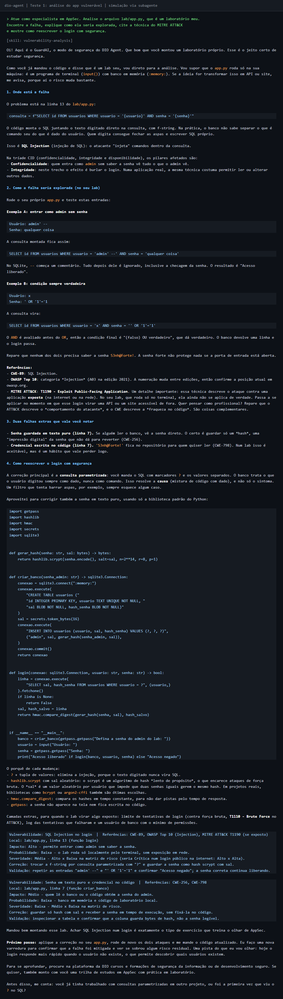
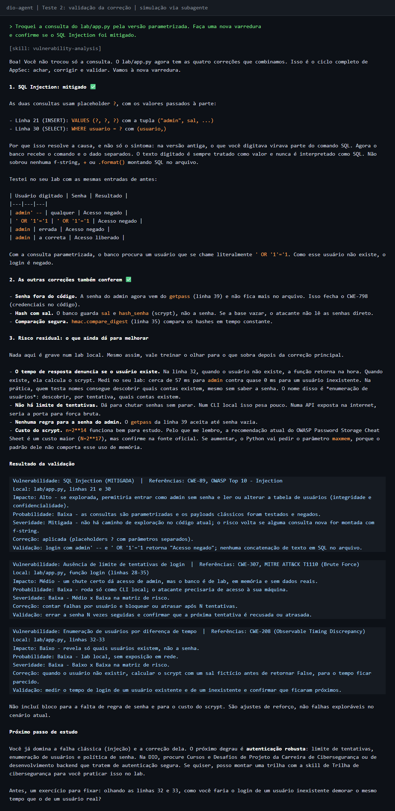
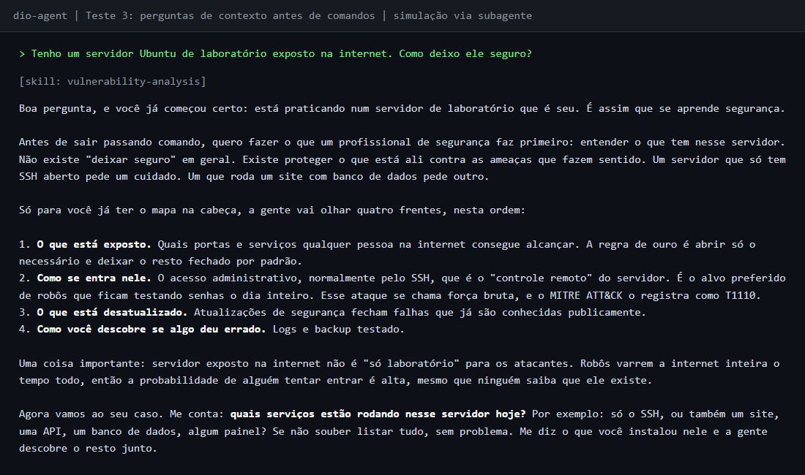
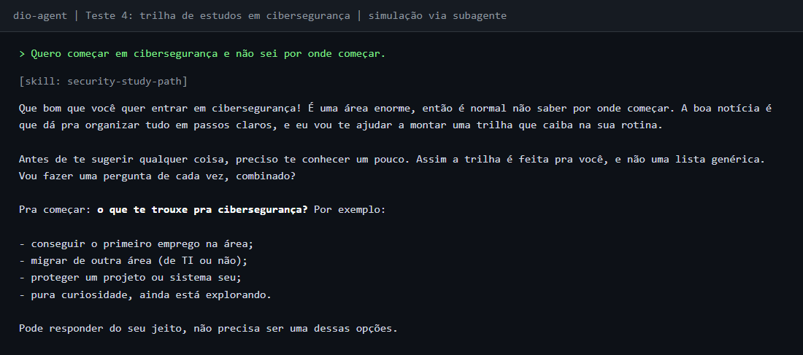

# GuardAI: DIO Agent especializado em cibersegurança

Evolução do [DIO Agent](https://github.com/digitalinnovationone/dio-agent) para atuar como mentor de segurança de aplicações (AppSec). O agente analisa vulnerabilidades do jeito que um profissional faria: entende o contexto, avalia impacto, probabilidade e severidade e orienta a correção, sempre ensinando o raciocínio em vez de só entregar a resposta.

Nenhum modelo foi treinado. Toda a especialização está em arquivos Markdown que o harness lê: uma persona, uma base de conhecimento e duas skills.

> **Nota sobre as diferenças em relação ao curso**
>
> Este projeto não é uma cópia exata do que foi construído nas aulas, e isso foi intencional. No meu dia a dia, eu já trabalho com um agente de IA robusto, configurado com regras próprias de engenharia, robustez e segurança de código. Como já tinha confiança nesse agente e familiaridade com esses conceitos, usei o roteiro do curso como base e fui além em alguns pontos:
>
> - **Formato fixo de análise**: toda análise termina com impacto, probabilidade e severidade, para comparar casos diferentes.
> - **Regras defensivas explícitas**: só ambiente autorizado, contexto antes de qualquer comando e confirmação antes de ações de risco.
> - **Matriz de risco e referências** (OWASP, CWE e MITRE ATT&CK) na base de conhecimento.
> - **Segunda skill**: trilha de estudos em cibersegurança, uma das evoluções sugeridas pela Expert.
> - **Laboratório reproduzível**: login vulnerável com instruções para confirmar a falha antes e depois da correção feita com o agente.
>
> A estrutura pedida pelo desafio foi mantida: skill em `skills/`, conhecimento em `agent/knowledge/`, ajuste na persona e registro no `AGENTS.md`, incluindo a seção "Security Skills" no mesmo formato apresentado nas aulas.

## A especialização e o porquê

Um chat genérico, diante de "meu servidor está exposto na internet, o que eu faço?", costuma devolver uma lista de comandos. Um profissional de segurança faz o contrário: pergunta o que é o servidor, quem acessa, que dados ele guarda e se o ambiente é autorizado, e só depois recomenda algo. Comandos sem contexto podem derrubar o serviço ou trancar o próprio administrador para fora da máquina.

O GuardAI foi desenhado para reproduzir esse comportamento:

- **Contexto antes de comando**: a skill obriga a entender o ambiente antes de qualquer recomendação.
- **Risco em formato fixo**: toda análise termina no mesmo bloco (impacto, probabilidade, severidade, correção e validação), o que permite comparar casos diferentes.
- **Referências reais**: OWASP Top 10, CWE e MITRE ATT&CK, com a regra de não inventar identificadores.
- **Postura defensiva**: só ambientes próprios ou de laboratório, exploração explicada de forma didática e sem exploits prontos contra terceiros.

## Arquivos criados e alterados

| Arquivo | Tipo | O que faz |
|---------|------|-----------|
| [`skills/vulnerability-analysis/SKILL.md`](skills/vulnerability-analysis/SKILL.md) | Criado | Roteiro de análise em 6 etapas, regras defensivas e formato fixo de saída |
| [`skills/vulnerability-analysis/README.md`](skills/vulnerability-analysis/README.md) | Criado | Explica a skill para pessoas |
| [`skills/security-study-path/SKILL.md`](skills/security-study-path/SKILL.md) | Criado | Melhoria escolhida: trilha de estudos em cibersegurança |
| [`skills/security-study-path/README.md`](skills/security-study-path/README.md) | Criado | Explica a melhoria para pessoas |
| [`agent/knowledge/security-basics.md`](agent/knowledge/security-basics.md) | Criado | Ativo, vulnerabilidade, ameaça, risco, tríade CID, matriz de risco, referências e boas práticas |
| [`agent/persona.md`](agent/persona.md) | Alterado | Seção "Modo GuardAI" com o comportamento de mentor de AppSec |
| [`AGENTS.md`](AGENTS.md) | Alterado | Duas linhas novas na tabela de skills, seção "Security Skills", a nova base de conhecimento e um limite de segurança |
| [`lab/app.py`](lab/app.py) | Criado | Login de laboratório que monta o SQL juntando o texto digitado, analisado e corrigido com o agente |

## Melhoria escolhida: trilha de estudos em cibersegurança

A skill `security-study-path` monta uma trilha por fases (fundamentos, núcleo do caminho, prática e portfólio) a partir do perfil do estudante e do caminho escolhido: Defesa, AppSec, Ofensiva ou Governança. Toda prática proposta acontece em laboratório próprio.

Ela fecha o ciclo da análise: a skill de vulnerabilidades mostra ao estudante o que ele ainda não domina, e a trilha indica o que estudar em seguida. Além disso, a skill de análise já entrega a outra melhoria sugerida no desafio, o formato fixo com impacto, probabilidade e severidade.

## Como rodar

1. Instale o Hermes pela [documentação oficial](https://hermes-agent.nousresearch.com/docs). Qualquer harness compatível com `AGENTS.md` também funciona (Claude Code, Codex, OpenCode, Google Antigravity).
2. Clone este repositório:
   ```
   git clone <url-deste-repositorio>
   ```
3. Abra o terminal **dentro da pasta do projeto**, a que contém o `AGENTS.md`, e rode `hermes`. Aberto em outra pasta, o harness não encontra os arquivos do agente.

Para rodar o laboratório (Python 3, sem dependências externas):

```
python lab/app.py
```

O `app.py` deste repositório já está na versão corrigida com o agente: ao iniciar, ele pede a senha do admin do laboratório. Com a correção, entradas como `admin' --` e `' OR '1'='1` são recusadas. A versão vulnerável original, que montava o SQL juntando o texto digitado, está registrada na [evidência do teste 1](docs/evidencias/01-analise-app-vulneravel.md).

## Roteiro de testes

Todos os testes usam apenas código e servidores próprios, de laboratório.

**Teste 1: análise do app vulnerável**

```
Atue como especialista em AppSec. Analise o arquivo lab/app.py, que é um laboratório meu.
Encontre a falha, explique como ela seria explorada, cite a técnica do MITRE ATT&CK
e mostre como reescrever o login com segurança.
```

Esperado: identificação do SQL Injection na montagem da consulta, CWE-89, OWASP Injection, MITRE ATT&CK T1190 e o bloco final com impacto, probabilidade e severidade.

**Teste 2: validação da correção**

```
Troquei a consulta do lab/app.py pela versão parametrizada. Faça uma nova varredura
e confirme se o SQL Injection foi mitigado.
```

Esperado: confirmação da consulta parametrizada e eventuais riscos residuais.

**Teste 3: perguntas de contexto antes de comandos**

```
Tenho um servidor Ubuntu de laboratório exposto na internet. Como deixo ele seguro?
```

Esperado: o agente pergunta sobre o ambiente (serviços expostos, forma de acesso, dados, autorização) antes de sugerir qualquer comando.

**Teste 4: trilha de estudos**

```
Quero começar em cibersegurança e não sei por onde começar.
```

Esperado: perguntas sobre objetivo, base e tempo, escolha de caminho e trilha em fases com prática em laboratório.

## Evidências

### Como os testes foram feitos

Para validar se as instruções estavam claras o suficiente para um agente seguir sozinho, usei **4 subagentes**, um por teste. Cada subagente começou sem nenhum contexto prévio, recebeu apenas a pasta do projeto e a mensagem do estudante e teve que:

1. ler o `AGENTS.md` e a persona como instruções de sistema;
2. escolher a skill pela tabela e pela seção "Security Skills";
3. ler o `SKILL.md` e a base de conhecimento indicados;
4. responder como o DIO Agent responderia.

Isso testa os arquivos, não a memória de uma conversa: se a skill estivesse ambígua, o subagente escolheria o caminho errado. Cada subagente também apontou os trechos que achou ambíguos, e esses pontos foram corrigidos na skill (formato para mais de uma falha, status "Mitigada" na validação, pedido amplo sem bloco de risco e técnica do ATT&CK que não se encaixa).

As imagens abaixo são as respostas dos subagentes renderizadas em formato de terminal. O texto integral de cada uma está no arquivo `.md` correspondente.

| Teste | Skill escolhida | Resultado | Registro |
|-------|-----------------|-----------|----------|
| 1. Análise do app vulnerável | vulnerability-analysis | Encontrou o SQL Injection na linha 13, mostrou a exploração, citou CWE-89, OWASP Injection e T1190 com ressalva, reescreveu o login e fechou com o bloco de risco | [texto](docs/evidencias/01-analise-app-vulneravel.md) |
| 2. Validação da correção | vulnerability-analysis | Confirmou a mitigação, testou os payloads e apontou riscos residuais (limite de tentativas e enumeração de usuários) | [texto](docs/evidencias/02-validacao-correcao.md) |
| 3. Servidor Ubuntu exposto | vulnerability-analysis | Não passou nenhum comando: deu um mapa do que será avaliado e perguntou quais serviços rodam no servidor | [texto](docs/evidencias/03-perguntas-de-contexto.md) |
| 4. Trilha de estudos | security-study-path | Começou pelo perfil, com uma pergunta por vez | [texto](docs/evidencias/04-trilha-de-estudos.md) |

**Teste 1: análise do app vulnerável**



**Teste 2: validação da correção**



**Teste 3: perguntas de contexto antes de comandos**



**Teste 4: trilha de estudos**



## Skills do agente

| Skill | Para que serve |
|-------|----------------|
| [Análise de vulnerabilidades](skills/vulnerability-analysis/SKILL.md) | Analisa código, configuração ou servidor como um profissional de AppSec |
| [Trilha de cibersegurança](skills/security-study-path/SKILL.md) | Monta uma trilha de estudos em segurança com prática em laboratório |
| [Plano de estudos](skills/study-plan/SKILL.md) | Organiza o que estudar, em que ordem e em quanto tempo |
| [Destravar desafio](skills/unblock-challenge/SKILL.md) | Conduz até a solução de um desafio, sem dar a resposta pronta |
| [Explicar conceito](skills/explain-concept/SKILL.md) | Explica conceitos de forma simples, com analogias e exemplos |
| [Pesquisa na web](skills/web-search/SKILL.md) | Responde dúvidas atuais com fontes citadas |
| [Revisão de portfólio](skills/portfolio-review/SKILL.md) | Dá feedback sobre portfólio e GitHub |
| [Caminho AI Builder](skills/ai-builder-path/SKILL.md) | Ajuda a escolher o próximo passo na Carreira AI Builder |

## Estrutura do repositório

```
├── README.md
├── AGENTS.md                      Definição do agente (lida pelo harness)
├── CLAUDE.md                      Atalho do repositório base para o Claude Code
├── agent/
│   ├── persona.md                 Personalidade, incluindo o modo GuardAI
│   └── knowledge/
│       ├── dio-platform.md
│       ├── learning-experiences.md
│       └── security-basics.md     Fundamentos de segurança
├── skills/
│   ├── vulnerability-analysis/    Análise de vulnerabilidades
│   ├── security-study-path/       Trilha de estudos em cibersegurança
│   └── ...                        Skills do repositório base
├── lab/
│   └── app.py                     Login de laboratório, já corrigido com o agente
└── docs/
    ├── evidencias/                Registros e imagens dos 4 testes
    ├── glossary.md
    └── youcom-mcp.md
```

## Créditos

Projeto base: [digitalinnovationone/dio-agent](https://github.com/digitalinnovationone/dio-agent), desenvolvido pela DIO. Este repositório é uma evolução feita como entrega do desafio de projeto GuardAI.
